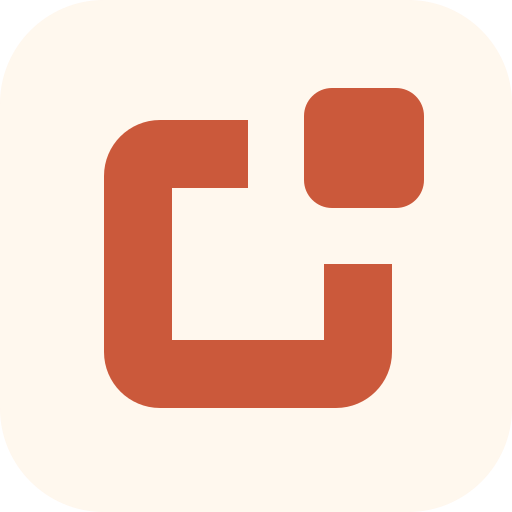
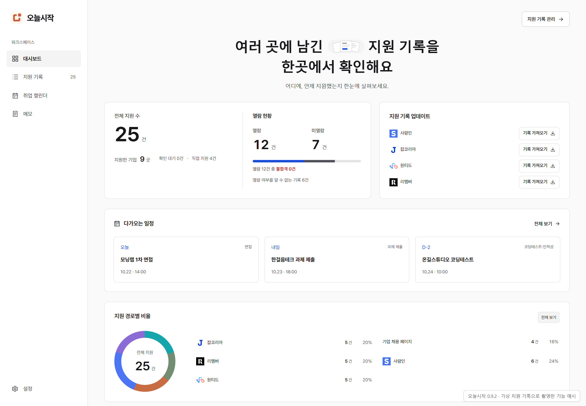
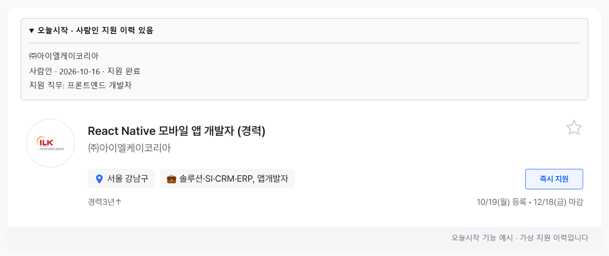
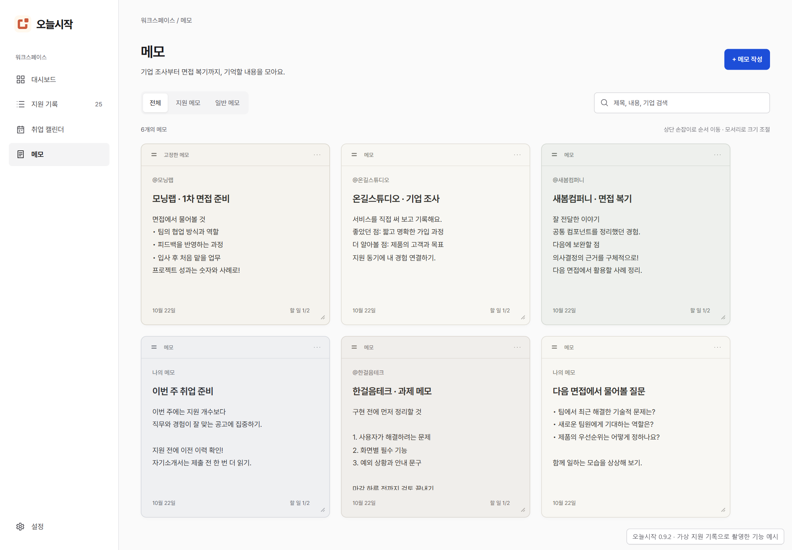

<div align="center">



# 오늘시작

**채용 사이트가 달라도, 이전에 지원한 회사인지 확인하세요.**

여러 곳에 남긴 지원 기록을 한곳에 모으고,<br />
기업 조사 메모와 면접 일정까지 내 브라우저에서 관리합니다.

`Chrome Extension` · `Manifest V3` · `React` · `TypeScript` · `로컬 저장`

**소스 공개 · 개인 사용 허용 · 재배포는 별도 허가**

[소개 페이지](https://pj6577.github.io/todaystart/) · [웹 스토어](https://chromewebstore.google.com/detail/dhgfnibbnjieajcmnohdkiandeljeaef) · [빠른 시작](#빠른-시작) · [개발하기](#개발하기) · [변경 기록](CHANGELOG.md) · [이용 조건](LICENSE)

</div>



## 지원하기 전에, 이전 기록부터

같은 회사의 공고를 다른 채용 사이트에서 다시 만나는 경우가 있습니다. 오늘시작은 저장한 지원 기록을 회사명으로 비교해 **이전에 지원한 경로·날짜·직무**를 공고 옆에 보여 줍니다.

회사명 표기가 다르거나 이름만 비슷한 경우에는 확인이 필요하다는 안내를 함께 표시합니다. 저장하지 않은 이력은 확인할 수 없으며, 실제 지원 여부와 동일 기업 여부는 사용자가 최종 확인합니다.



## 주요 기능

| 기능 | 할 수 있는 일 |
| --- | --- |
| 이전 지원 이력 안내 | 같은 사이트와 다른 사이트에서 가져온 기업 이력을 공고에서 확인 |
| 지원 기록 모으기 | 사람인·잡코리아·원티드·리멤버의 지원 현황을 가져와 중복 병합 |
| 직접 추가 | 기업 홈페이지·이메일 등 다른 경로의 지원도 기록 |
| 기록 관리 | 기업·직무 검색, 경로 필터, 열별 정렬, 상태 수정, 100건 단위 페이지 이동 |
| 스티커 메모 | 기업 `@언급`, 체크리스트, 자동 저장, 드래그 정렬과 크기 조절 |
| 취업 캘린더 | 면접·과제·마감·코딩테스트 일정을 지원 기록에 연결 |
| 백업 | 검색 결과 전체 CSV 내보내기와 기록·메모·일정 JSON 백업·복원 |
| 화면 설정 | 시스템·라이트·다크 모드 |

### 사이트별 지원 범위

| 사이트 | 지원 현황 가져오기 | 공고에서 이전 지원 확인 |
| --- | --- | --- |
| 사람인 | 지원 현황 및 페이지 이동 | 검색·직무별 목록·상세 |
| 잡코리아 | 지원 현황 및 페이지 이동 | 검색·채용 목록·상세 |
| 원티드 | 지원 완료 목록 및 확인 가능한 정보 보강 | 공고 상세 |
| 리멤버 | 현재 지원 현황 카드 | 채용공고 목록 |

리멤버는 마지막 페이지 근거를 확인하지 못하면 현재 화면을 저장한 뒤 중지합니다. 사이트의 화면 구조와 로그인 상태에 따라 가져오기가 제한될 수 있습니다. 구조를 인식하지 못하면 기존 기록을 유지하고 확인 필요 상태를 표시합니다.

### 기업 조사부터 면접 복기까지



화면 예시는 가상 지원 기록·메모·일정으로 촬영한 **0.9.2 자료**입니다. 현재 버전은 **0.10.1**이며, 준비 보드·직접 추가 폼 수정·개발자 기여 카드는 [변경 기록](CHANGELOG.md)에 정리했습니다.

## 내 브라우저에 저장

지원 기록·메모·일정은 IndexedDB에, 설정은 Chrome 확장 프로그램 저장소에 보관합니다. 회원가입이나 별도 서버·원격 데이터베이스·AI API 키 없이 사용할 수 있습니다.

- 가져오기와 지원 관찰은 로그인한 채용 사이트의 화면에서 실행됩니다.
- 지원 완료 근거를 확인하지 못한 제출 시도는 확인 대기로 구분합니다.
- 기업 ID는 사이트 안에서만 비교합니다. 다른 사이트에서는 회사명을 기준으로 확인합니다.
- 날짜를 확인하지 못한 기록에 오늘 날짜를 임의로 넣지 않습니다.
- 브라우저 프로필이나 확장 프로그램을 삭제하기 전에는 JSON 백업을 권장합니다.

자세한 범위는 [개인정보 처리 안내](docs/privacy-policy.md)를 참고하세요.

## 빠른 시작

### 사용하기

1. [Chrome 웹 스토어](https://chromewebstore.google.com/detail/dhgfnibbnjieajcmnohdkiandeljeaef)에서 오늘시작을 설치합니다.
2. 사용할 채용 사이트에 로그인합니다.
3. 팝업이나 관리 화면에서 해당 사이트의 지원 기록을 가져옵니다.
4. 공고에서 이전 지원 안내를 확인하고, 필요한 메모와 일정을 남깁니다.

스토어 배포 버전과 저장소의 개발 버전은 다를 수 있습니다. 로컬 버전은 아래 방법으로 빌드합니다.

### 소스에서 설치하기

Node.js 22 이상과 npm이 필요합니다.

```sh
git clone https://github.com/pj6577/todaystart.git
cd todaystart
npm ci
npm run build
```

Chrome의 `chrome://extensions`에서 **개발자 모드 → 압축해제된 확장 프로그램을 로드합니다**를 선택하고 `build/chrome-mv3-prod` 폴더를 불러옵니다.

기존 로컬 설치를 갱신할 때는 같은 설치 경로를 유지하고 확장 프로그램·관리 화면·채용 사이트 탭을 새로고침하세요. 다른 폴더로 설치하면 저장소가 분리될 수 있으므로 먼저 백업하세요.

## 개발하기

```sh
npm run dev          # build/chrome-mv3-dev를 Chrome에 로드
npm run typecheck    # 타입 검사
npm test            # 단위 검사
npm run build       # 프로덕션 빌드
```

브라우저 검사는 프로덕션 빌드 후 실행합니다.

```sh
npx playwright install chromium
npm run test:e2e
```

```sh
npm run package     # build/chrome-mv3-prod.zip 생성
```

빌드와 브라우저 검사를 동시에 실행하지 마세요. 브라우저 검사는 임시 Chromium 프로필과 합성 문서를 사용하며 실제 계정에 로그인하거나 입사지원을 제출하지 않습니다.

0.10.0에서 타입 검사·단위 검사 **420개**·프로덕션 빌드와 관련 브라우저 검사 **13개**를 확인했습니다. 범위와 한계는 [0.10.0 검증 기록](docs/validation-0.10.0.md)에 정리했습니다.

### 코드 구조

```text
src/
  background/    요청 권한 검사와 기능별 메시지 처리
  messaging/     요청 스키마와 요청별 응답 타입
  core/          기록 모델, 기업 비교, 메모·일정과 색인
  platforms/     사이트별 DOM 파서와 페이지 이동
  contents/      공고 감지, 지원 관찰, 페이지 갱신
  collection/    지원 현황 수집과 전체 페이지 순회
  storage/       지원 기록·메모·백업 저장소, DB 스키마와 설정
  submission/    지원 시도·완료 관찰
  ui/            대시보드·기록·메모·캘린더 화면
tests/
  fixtures/      합성 및 비식별 DOM 사례
  unit/          파서·매칭·저장·상태 회귀 검사
  e2e/           설치된 확장 프로그램의 브라우저 검사
```

메시지 흐름, 저장소의 트랜잭션 경계, 화면 상태 분리는 [아키텍처 문서](docs/architecture.md)에 정리했습니다.

Zod는 현재 번들 호환성 때문에 **3.24.4**로 고정되어 있습니다. 변경 시 타입 검사뿐 아니라 빌드된 확장 프로그램의 브라우저 검사도 확인해야 합니다.

## 이미지와 배포 자료

- `assets/`: 실행 또는 재제작에 쓰는 원본 자산과 출처·서체 라이선스.
- `docs/images/`: README와 현재 검증 문서의 대표 이미지. [이미지 출처](docs/images/README.md)를 함께 보관합니다.
- 과거 홍보 이미지·목업·실험 결과·버전별 ZIP은 로컬 보관 자료로 분리하고 Git에서 제외합니다.
- 설치 ZIP은 빌드 결과만 패키징하며, 원본 이미지·캡처·임시 도구를 넣지 않습니다.

[자료 분류 기준](docs/asset-categories.md) · [성능 측정](docs/optimization-and-open-source.md) · [키·계정 정보 점검](docs/secret-audit-2026-10-27.md)

## 기여와 이용 범위

사이트 구조 변경은 개인 정보와 인증정보를 제거한 DOM 사례로 재현합니다. [기여 안내](CONTRIBUTING.md)를 참고하세요.

이 저장소는 **TodayStart Personal Use Source License 1.0**으로 소스를 공개합니다. 표준 오픈소스 라이선스가 아니며, 전체 조건은 [LICENSE](LICENSE)를 따릅니다.

- 본인의 취업 활동·학습·평가를 위한 열람, 개인 빌드·사용과 비공개 수정은 허용합니다.
- 수정본을 포함한 소스·설치 ZIP·확장 프로그램의 재배포, 상업적 이용, 다른 사람을 대상으로 한 서비스 운영은 저작권자의 **사전 서면 허가**가 필요합니다.
- 개인정보를 개발자·운영자·분석 서비스 등 외부로 수집·전송하는 기능을 추가·사용할 권한은 부여하지 않습니다. 본인 기록을 해당 채용 사이트에서 가져와 로컬에 보관하거나 직접 파일로 내보내는 기능과 구분합니다.
- 공개 GitHub 저장소의 열람·GitHub 내 포크는 플랫폼 약관에 따라 가능합니다. 이것이 설치본 재배포나 별도 서비스 운영 허가를 뜻하지는 않습니다.

공식 설치 경로는 위 웹 스토어 링크입니다. 제3자 수정본이 공식 배포판과 같은 개인정보 처리 방식을 유지한다고 보증하지 않습니다. 이용 조건은 권한의 범위를 정하며 무단 복제나 유출을 기술적으로 차단하는 장치는 아닙니다.

서체·외부 플랫폼 로고·의존성은 프로젝트 이용 조건과 별도로 [제3자 고지](THIRD_PARTY_NOTICES.md)를 확인하세요. 로고의 출처를 기록했다는 이유만으로 재배포 권한을 부여하지 않습니다.
