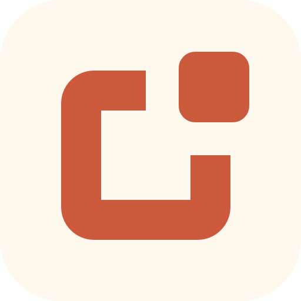
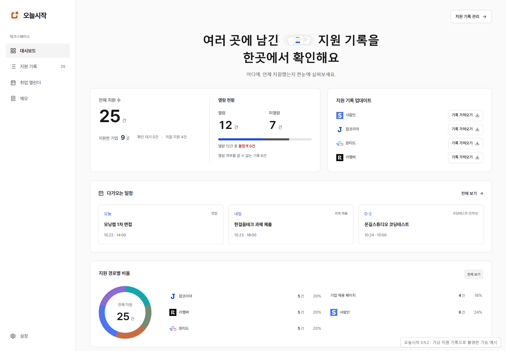
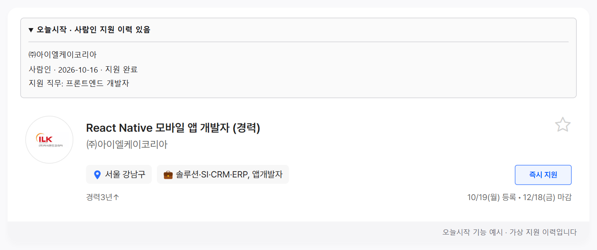
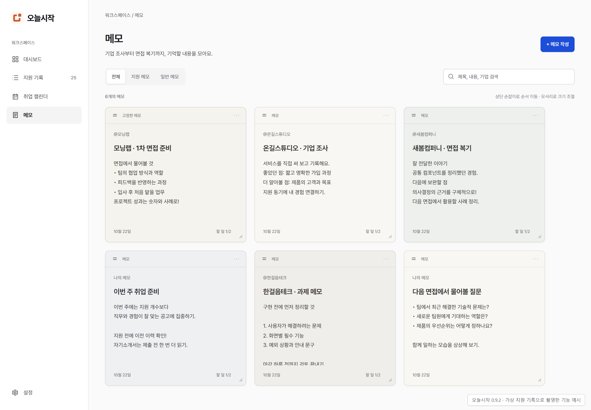

<div align="center">



# 오늘시작

지원했던 회사, 공고를 보면서 확인해요.

사람인·잡코리아·원티드·리멤버의 공고를 찾고,<br />
지원 기록과 기업 메모, 면접 일정을 내 브라우저에 모아요.

[**Chrome에 설치하기**](https://chromewebstore.google.com/detail/dhgfnibbnjieajcmnohdkiandeljeaef) &nbsp; · &nbsp; [소개 페이지](https://pj6577.github.io/todaystart/)

</div>

<br />



<sub>화면 예시는 가상 기록으로 촬영한 0.9.2 자료예요. 현재 버전은 0.12.0이며, 달라진 내용은 [변경 기록](CHANGELOG.md)에서 볼 수 있어요.</sub>

## 공고를 보다가 이전 지원이 궁금할 때

다른 사이트에서 같은 회사의 공고를 다시 만나도, 전에 어디로 지원했는지 확인할 수 있어요.  
오늘시작이 저장된 기록을 회사명으로 비교해 공고 옆에 지원 경로와 날짜, 당시 직무를 보여줘요.



회사 이름의 표기가 다르거나 비슷한 이름만 찾았다면 따로 안내해요.  
아직 가져오지 않은 기록은 찾을 수 없으니, 안내가 없더라도 실제 지원 여부와 같은 회사인지는 한 번 확인해 주세요.

## 이런 일을 할 수 있어요

| 하고 싶은 일 | 오늘시작에서 |
| --- | --- |
| 새 공고 찾기 | 네 사이트를 검색어·직군·지역·경력으로 함께 검색하고, 지원했던 기업은 제외하기 |
| 이전 지원 확인하기 | 같은 사이트나 다른 사이트에 남긴 지원 이력을 공고에서 확인하기 |
| 지원 내역 정리하기 | 네 사이트의 지원 현황을 가져와 중복 기록을 합치고, 기업 홈페이지·이메일 지원도 직접 추가하기 |
| 기록 찾아보기 | 기업·직무 검색, 경로 필터, 열별 정렬, 상태 수정과 100건 단위 페이지 이동 |
| 기업 메모 남기기 | 기업 `@언급`, 체크리스트, 자동 저장, 메모 드래그 정렬과 크기 조절 |
| 일정 챙기기 | 면접·과제·마감·코딩테스트 일정을 지원 기록에 연결하기 |
| 백업하기 | 검색된 지원 기록 전체를 CSV로 내보내고, 기록·메모·일정은 JSON으로 백업·복원하기 |

화면은 시스템·라이트·다크 모드 중 고를 수 있어요.  
공고 통합검색은 현재 실험 기능이에요.

<details>
<summary>기업 메모 화면 보기</summary>

<br />



기업을 조사할 때 남긴 내용과 면접 준비 체크리스트를 모아둘 수 있어요.  
면접이 끝나면 같은 기록에 복기 메모를 이어 적으세요.

</details>

## 설치하고 시작하기

1. [Chrome 웹 스토어](https://chromewebstore.google.com/detail/dhgfnibbnjieajcmnohdkiandeljeaef)에서 설치해요.
2. 사용하는 채용 사이트에 로그인해요.
3. 오늘시작 팝업이나 관리 화면에서 사이트별 지원 기록을 가져와요.
4. 공고를 둘러보면서 이전 지원 안내를 확인하고, 메모와 일정을 남겨보세요.

스토어 버전과 저장소의 릴리즈 버전은 다를 수 있어요.  
설치 ZIP은 [GitHub 릴리즈](https://github.com/pj6577/todaystart/releases/latest)에서 받을 수 있고, 직접 빌드하는 방법은 아래에 있어요.

### 어디에서 쓸 수 있나요?

| 사이트 | 가져오는 지원 내역 | 이전 지원 안내가 보이는 곳 |
| --- | --- | --- |
| 사람인 | 지원 현황, 다음 페이지까지 | 검색·직무별 목록·상세 |
| 잡코리아 | 지원 현황, 다음 페이지까지 | 검색·채용 목록·상세 |
| 원티드 | 지원 완료 목록과 확인할 수 있는 추가 정보 | 공고 목록·상세 |
| 리멤버 | 현재 화면의 지원 현황 카드 | 채용공고 목록 |

사이트 화면이 바뀌거나 로그인 상태가 달라지면 기록을 가져오지 못할 수 있어요.  
화면 구조를 읽지 못했을 때는 기존 기록을 남겨두고 ‘확인 필요’로 알려줘요.

<details>
<summary>잡코리아·리멤버에서 알아둘 점</summary>

0.12.0부터 잡코리아 공고 상세의 ‘지원완료’ 버튼과 기업명·직무를 확인해요.  
그 기업의 기록이 없다면 자동으로 추가하며, 자동 기록과 잡코리아 수집 설정을 따라요.  
실제 지원일이 화면에 없으면 날짜 미확인으로 보관해요.

리멤버는 마지막 페이지라는 근거를 찾지 못하면 현재 화면의 기록을 저장한 뒤 멈춰요.

</details>

## 공고 통합검색 써보기

관리 화면에서 **공고 통합검색**을 열어보세요.  
검색어를 입력하거나 직군·직무, 지역, 경력을 고르면 네 사이트의 공고를 함께 살펴볼 수 있어요.

- 이미 지원한 기업을 빼고 싶으면 ‘지원 기업 제외하기’를 켜세요.
- 관심 공고는 카드의 북마크 아이콘으로 저장하고, 상단의 북마크 버튼에서 다시 볼 수 있어요.
- ‘지원 이력 있음’ 배지를 누르면 이전 지원 경로와 날짜, 직무를 확인할 수 있어요.
- 아래로 스크롤하면 다음 공고를 이어 가져와요. 공고 카드는 데스크톱에서 대시보드와 같은 폭의 3열로 보여요.

검색 응답은 브라우저에서 각 사이트로 직접 요청해요.  
북마크로 저장하지 않은 결과는 현재 화면의 메모리에만 남아요.  
사이트의 접근 제한이나 화면 변경 때문에 일부 결과를 가져오지 못할 수도 있어요.

<details>
<summary>검색 조건, 결과 순서와 경력 범위 자세히 보기</summary>

### 조건 고르기

직군·직무, 지역, 경력 버튼을 누르면 같은 필터 창이 열려요.  
왼쪽 메뉴에서 조건과 검색 사이트를 오가며 고른 뒤 ‘적용’을 누르면 검색해요.  
고른 항목은 체크 표시와 중립색 배경으로 구분하고, 적용한 조건은 화면의 칩에서 하나씩 해제할 수 있어요.  
모바일에서는 필터 창이 화면 아래쪽에 열려요.

0.11.1부터 마지막으로 적용한 검색어·조건·검색 사이트·지원 기업 제외 설정 한 건을 브라우저에 기억해요.  
다시 열면 설정만 복원하고, 검색을 실행할 때 새 결과를 가져와요.

기존 검색 사이트 선택도 유지해요.  
리멤버가 선택되어 있지 않다면 ‘검색 사이트’에서 추가해 주세요.

### 경력 고르기

- ‘신입~3년’, ‘2~5년’ 같은 빠른 조건을 고를 수 있어요.
- 직접 지정할 때 최소 경력은 신입~20년, 최대 경력은 1~20년 중 고를 수 있어요.
- 신입·경력·경력무관 포함 여부도 각각 조절할 수 있어요.
- 최소 경력을 신입으로 고르면 신입도 함께 포함해요. 경력 선택을 해제하면 연차 범위도 지워져요.

### 결과 순서 바꾸기

기본 순서는 각 조회 묶음 안에서 사람인 → 잡코리아 → 원티드 → 리멤버예요.  
상단 플랫폼 탭을 끌면 탭과 각 묶음의 표시 순서가 함께 바뀌고, 다음에 열어도 유지돼요.

터치와 Alt+좌우 방향키도 사용할 수 있고, Esc로 끌기를 취소할 수 있어요.  
‘전체’와 북마크 버튼의 위치는 고정이에요.

다음 페이지는 한 묶음으로 모아 선택한 플랫폼 순서대로 목록 맨 아래에 붙여요.  
북마크 목록은 최근에 저장한 순서로 보여요.

### 사이트별 검색과 북마크

네 사이트 모두 검색어와 조건을 함께 유지해요.

원티드에서 검색어와 직무를 함께 고르면 두 검색 목록의 공고 ID를 여러 페이지에 걸쳐 비교해요.  
조건에 맞는 공고를 찾기까지 추가 조회가 필요할 수 있어요.

리멤버는 공개 검색 API에 조건을 전달해요.  
경력무관과 연차를 함께 고르면 각각 조회한 결과를 합쳐요.

이전 지원 안내는 저장된 지원 완료 기록과 기업명을 비교해 표시해요.  
카드의 지원 이력 배지 오른쪽에 있는 북마크로 공고를 저장하거나 해제할 수 있어요.  
북마크는 현재 브라우저에 보관하므로 새로고침 후에도 남아요.

</details>

## 기록은 내 브라우저에 있어요

지원 기록·메모·일정은 IndexedDB에, 설정은 Chrome 확장 프로그램 저장소에 보관해요.  
회원가입이나 별도 서버, 원격 데이터베이스, AI API 키 없이 쓸 수 있어요.

- 지원 내역 가져오기와 지원 관찰은 로그인한 채용 사이트 화면에서 실행해요.
- 지원 완료 근거를 찾지 못한 제출 시도는 ‘확인 대기’로 구분해요.
- 기업 ID는 같은 사이트 안에서만 비교하고, 다른 사이트의 기록은 회사명으로 비교해요.
- 지원 날짜를 찾지 못한 기록에 오늘 날짜를 대신 넣지는 않아요.

브라우저 프로필이나 확장 프로그램을 지우기 전에는 JSON 백업을 받아두세요.  
데이터를 다루는 범위는 [개인정보 처리 안내](docs/privacy-policy.md)에 적어두었어요.

## 직접 빌드하거나 개발하려면

<details>
<summary>소스에서 설치하기 · 개발 명령어 · 코드 구조</summary>

### 소스에서 설치하기

Node.js 22 이상과 npm이 필요해요.

```sh
git clone https://github.com/pj6577/todaystart.git
cd todaystart
npm ci
npm run build
```

Chrome의 `chrome://extensions`에서 **개발자 모드 → 압축해제된 확장 프로그램을 로드합니다**를 선택하고 `build/chrome-mv3-prod` 폴더를 불러오세요.

기존 로컬 설치를 갱신할 때는 같은 설치 경로를 유지해 주세요.  
확장 프로그램과 관리 화면, 채용 사이트 탭도 새로고침해야 해요.  
다른 폴더로 설치하면 저장소가 분리될 수 있으니 먼저 백업을 받아두세요.

### 개발 명령어

`Chrome Extension` · `Manifest V3` · `React` · `TypeScript` · `로컬 저장`

```sh
npm run dev          # build/chrome-mv3-dev를 Chrome에 로드
npm run typecheck    # 타입 검사
npm test            # 단위 검사
npm run build       # 프로덕션 빌드
```

브라우저 검사는 프로덕션 빌드를 마친 뒤 실행해요.

```sh
npx playwright install chromium
npm run test:e2e
```

```sh
npm run package     # build/chrome-mv3-prod.zip 생성
```

빌드와 브라우저 검사는 동시에 실행하지 마세요.  
브라우저 검사는 임시 Chromium 프로필과 합성 문서를 사용해요.  
실제 계정에 로그인하거나 입사지원을 제출하지 않아요.

0.10.3에서는 타입 검사, 단위 검사 501개, 프로덕션 빌드와 관련 브라우저 검사 28개를 확인했어요.  
어디까지 확인했는지는 [0.10.3 검증 기록](docs/validation-0.10.3.md)에서 볼 수 있어요.

### 통합검색 시연

```sh
npm run demo:search  # 임시 Chromium 프로필에서 실제 사이트 검색
```

실행 방법과 브라우저·공개 HTTP별 검증 범위는 [통합검색 기록](docs/job-search-demo.md)에 정리했어요.

### 코드 구조

```text
src/
  background/    요청 권한 검사와 기능별 메시지 처리
  messaging/     요청 스키마와 요청별 응답 타입
  core/          기록 모델, 기업 비교, 메모·일정과 색인
  platforms/     사이트별 DOM 파서와 페이지 이동
  contents/      공고 감지, 지원 관찰, 페이지 갱신
  collection/    지원 현황 수집과 전체 페이지 순회
  storage/       지원 기록·메모·백업 저장소, DB 스키마와 설정
  submission/    지원 시도·완료 관찰
  search/        통합검색 요청·파서·검색 조건·로컬 지원 기업 색인
  styles/        공통 테마·대시보드·기록·설정·반응형 스타일
  ui/            대시보드·기록·메모·캘린더 화면
    primitives/  shadcn 기반 버튼·폼·대화상자·팝오버·선택창
tests/
  fixtures/      합성 및 비식별 DOM 사례
  unit/          파서·매칭·저장·상태 회귀 검사
  e2e/           설치된 확장 프로그램의 브라우저 검사
```

메시지 흐름과 저장소의 트랜잭션 경계, 화면 상태 분리는 [아키텍처 문서](docs/architecture.md)에 정리했어요.

Zod는 현재 번들 호환성 때문에 `3.24.4`로 고정했어요.  
버전을 바꿀 때는 타입 검사와 함께, 빌드한 확장 프로그램의 브라우저 검사도 확인해 주세요.

</details>

<details>
<summary>이미지와 배포 자료</summary>

- `assets/`에는 실행·재제작에 쓰는 원본 자산과 출처, 서체 라이선스를 보관해요.
- `docs/images/`에는 README와 현재 검증 문서의 대표 이미지를 보관해요. [이미지 출처](docs/images/README.md)도 함께 남겨요.
- 과거 홍보 이미지와 목업, 실험 결과, 버전별 ZIP은 로컬에 따로 보관하고 Git에서는 제외해요.
- 설치 ZIP에는 빌드 결과만 넣어요. 원본 이미지나 캡처, 임시 도구는 넣지 않아요.

[자료 분류 기준](docs/asset-categories.md)과 [성능 측정](docs/optimization-and-open-source.md), [키·계정 정보 점검](docs/secret-audit-2026-10-27.md) 기록도 볼 수 있어요.

</details>

## 기여와 이용 범위

사이트 화면이 바뀌어 동작하지 않는다면, 개인정보와 인증정보를 지운 DOM 사례로 재현해 주세요.  
자세한 방법은 [기여 안내](CONTRIBUTING.md)에 있어요.

소스는 공개되어 있고, 개인 사용과 비공개 수정은 가능해요.  
재배포와 상업적 이용에는 별도 허가가 필요해요.

<details>
<summary>라이선스와 재배포 조건 확인하기</summary>

이 저장소는 **TodayStart Personal Use Source License 1.0**으로 소스를 공개합니다.  
표준 오픈소스 라이선스가 아니며, 전체 조건은 [LICENSE](LICENSE)를 따릅니다.

- 본인의 취업 활동·학습·평가를 위한 열람, 개인 빌드·사용과 비공개 수정은 허용합니다.
- 수정본을 포함한 소스·설치 ZIP·확장 프로그램의 재배포, 상업적 이용, 다른 사람을 대상으로 한 서비스 운영은 저작권자의 **사전 서면 허가**가 필요합니다.
- 개인정보를 개발자·운영자·분석 서비스 등 외부로 수집·전송하는 기능을 추가·사용할 권한은 부여하지 않습니다. 본인 기록을 해당 채용 사이트에서 가져와 로컬에 보관하거나 직접 파일로 내보내는 기능과 구분합니다.
- 공개 GitHub 저장소의 열람·GitHub 내 포크는 플랫폼 약관에 따라 가능합니다. 이것이 설치본 재배포나 별도 서비스 운영 허가를 뜻하지는 않습니다.

공식 설치 경로는 위 웹 스토어 링크입니다.  
제3자 수정본이 공식 배포판과 같은 개인정보 처리 방식을 유지한다고 보증하지 않습니다.  
이용 조건은 권한의 범위를 정하며 무단 복제나 유출을 기술적으로 차단하는 장치는 아닙니다.

서체·외부 플랫폼 로고·의존성은 프로젝트 이용 조건과 별도로 [제3자 고지](THIRD_PARTY_NOTICES.md)를 확인하세요.  
로고의 출처를 기록했다는 이유만으로 재배포 권한을 부여하지 않습니다.

</details>
