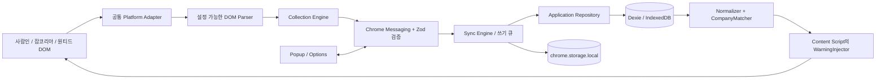

# 오늘시작 아키텍처

## 코드 책임과 의존성

메시지는 `messaging/protocol.ts`의 Zod 스키마로 검증하고 `messaging/contracts.ts`의 요청별 응답 타입으로 연결합니다. `rpc({ type: "note_save", ... })`의 반환값은 호출부에서 타입을 지정하지 않아도 메모로 추론됩니다. UI와 Content Script는 같은 `Snapshot` 계약을 사용합니다. 메모·일정·다른 탭의 수집 상태 등 선택 필드는 호출자 권한에 따라 제외합니다.

| 경계 | 담당 모듈 | 책임 |
| --- | --- | --- |
| Chrome 진입점 | `background.ts` | 이벤트 등록, 요청·탭 종료 작업의 단일 큐, 변경 알림 |
| 요청 권한·분배 | `background/authorization.ts`, `router.ts` | 확장 ID·출처·프레임 검사, 스키마 검증, 타입 검사된 처리기 호출 |
| 페이지 명령 | `messaging/page-protocol.ts`, `collection/page-commands.ts` | 페이지 상태·수집·이동·진단의 요청/응답 타입, 작업 ID 검증과 명령별 실행 |
| 기능 처리 | `background/applications.ts`, `planner.ts`, `history.ts`, `submissions.ts`, `snapshots.ts`, `management.ts` | 기능별 검증·저장·응답, 수집 작업 소유권, 초기화 세대 확인 |
| DB 스키마·이전 | `storage/database.ts` | Dexie 테이블과 기존 버전 이전 |
| 지원 기록 | `storage/repository.ts` | 지원 기록 병합·식별자 승격·안정적인 연결 유지, 저장소 접근 창구 |
| 메모·일정 | `storage/planner-repository.ts` | 낙관적 동시 편집 검사, 메모 언급·일정 연결 검증, 보드 배치 |
| 백업 | `storage/backup-schema.ts`, `backup-repository.ts` | 백업 형식 검증, 기존 기록 병합, 연결 ID 재매핑 |
| 사이트 경고 | `platforms/posting-warnings.ts` | 기업 매칭 캐시, 표시 설정, 중복 렌더 방지·경고 복구 |
| 현재 페이지 수집 상태 | `collection/history-session.ts` | 명시적 가져오기·자동 수집의 우선순위, 전체 수집 재시도 유지, 초기화 일시 정지 |
| 페이지 수명 | `platforms/page-lifecycle.ts` | DOM·부모·초기 탐색 관찰자, 갱신·준비·URL 타이머, 페이지 종료와 뒤로 가기 복원 |
| 제출 관찰 | `submission/events.ts`, 사이트별 `*-events.ts`, `attempt-events.ts` | 관찰 출처 검증, 사이트별 완료 근거, 공통 시도·응답 상태 전이 |
| 제출 임시 상태 | `submission/store.ts`, `context-links.ts`, `tracker.ts` | 유효기간과 최대 보관 수, 공고·지원창 연결, 실제 지원 기록 저장과 이력 대조 |
| 관리 화면 데이터 | `ui/use-workspace-data.ts` | 전체·메모 전용 스냅샷 구독, 초기화 세대와 임시 저장 동기화 |
| 메모·일정 편집 | `ui/use-planner-editors.ts` | 새 항목·기존 항목·임시 저장 복구와 상세 화면 복귀 상태 |
| 메모 자동 저장 | `ui/use-note-autosave.ts` | 저장 직렬화, 저장 중 추가 편집, 버전 충돌·임시 저장·별도 메모 저장 |
| 설정·기록 대화상자 | `ui/settings-page.tsx`, `record-dialogs.tsx` | 설정 표시와 기록 수정·삭제 UI, 입력 포커스 |

`ApplicationRepository`는 기존 호출부의 접근 창구를 유지하며 같은 Dexie 인스턴스를 메모·일정 저장소와 백업 저장소에 전달합니다. 복원은 지원 기록·연결·메모·일정·보드 전체를 하나의 트랜잭션에 묶습니다. 내부 병합도 그 트랜잭션에 참여하므로 뒤쪽 메모 저장이 실패하면 앞에서 추가한 지원 기록과 연결도 롤백됩니다. 지원 기록 삭제와 연결 변경도 관련 테이블을 함께 갱신합니다.

메모만 저장한 경우에는 `plannerRevision`으로 확장 UI의 메모 스냅샷만 갱신합니다. 지원 기록이나 설정이 바뀌면 기존 `revision`·설정 알림으로 사이트 경고도 갱신합니다. Content Script의 DOM 관찰·경로 감지·페이지 명령은 `contents/jobs.ts`에서 조정하고, 매칭·표시와 수집 세션 상태는 각각의 모듈이 맡습니다.

새 메시지를 추가할 때는 요청 스키마, `ResponseMap`, 기능 처리기를 함께 추가해야 타입 검사를 통과합니다. 새 DB 필드는 `database.ts`의 이전 정책과 백업 스키마를 함께 확인합니다. 분리된 저장소 안에서 별도 DB를 만들거나 복원 중 트랜잭션 밖의 비동기 작업을 추가하지 않습니다.

페이지 명령에도 별도 요청 스키마와 `PageResponseMap`을 적용합니다. 팝업과 전체 수집기는 같은 전송 함수를 사용하며, 명령 실패와 연결 끊김을 구분합니다. `SYNC_PAGE`의 선택적 `runId`는 UUID만 허용하고, 실행 시 현재 작업 ID·상태를 다시 확인합니다. 명령 수신부의 확장 ID·확장 페이지 검사는 Content Script 진입점에 유지합니다.

`PageLifecycle`은 페이지당 한 번 시작합니다. 현재 루트가 없어지면 이전 루트의 관찰자는 해제하고, 새 루트를 찾을 때까지 기존 부모 관찰과 제한 시간의 탐색을 유지합니다. 일반 페이지 종료는 DOM 관찰자·타이머·Chrome 및 DOM 이벤트 구독을 모두 정리합니다. 뒤로 가기 캐시에 보관되는 `pagehide`에서는 관찰과 타이머만 중단하고, `pageshow`에서 다시 시작합니다. 이 수명 전환은 브라우저가 발생시킨 이벤트에만 반응합니다. URL 비교는 표시 중인 페이지에서 초당 한 번 수행하며, 실제 URL 변경에만 DOM 갱신을 예약합니다.

제출 관찰은 같은 Service Worker 큐 안에서 처리합니다. 공통 출처 검사 후 이벤트 종류에 맞는 처리기로 분배하며, 사람인 완료 URL·응답 ID, 잡코리아 공고와 지원창의 연결, 원티드 클릭과 완료 경로의 검증을 각각 유지합니다. 공통 시도 처리기는 문서·프레임·요청 ID 일치와 확인 완료 상태 보호를 담당합니다. `SubmissionTracker`는 검증된 시도를 실제 지원 기록으로 만들고 지원 현황과 대조하는 역할을 맡습니다.

메모 편집 컴포넌트는 입력·메뉴·포커스·바깥 클릭을 맡고, 자동 저장 훅은 편집 순번과 저장된 순번을 관리합니다. 저장 중 내용이 바뀌면 첫 응답의 버전을 받은 뒤 최신 내용을 다음 저장으로 전송합니다. 충돌 시 자동 재시도를 멈추고 임시 내용을 보존하며, 명시적 다시 저장 또는 새 식별자의 별도 메모 저장으로 복구합니다. 설정 화면과 기록 대화상자는 별도 컴포넌트로 분리하고, 전체 화면 알림·새로고침·가져오기 작업은 관리 화면이 조정합니다.

2026-10-27 리팩토링 검증: 단위 테스트 394개와 타입 검사·프로덕션 빌드를 통과했습니다. 브라우저 전체 실행에서 152개가 통과했고, 직접 추가 시나리오의 오래된 버튼 선택자와 리멤버 경로 분류 기대값을 수정한 뒤 해당 1개도 재실행해 통과했습니다. 총 153개 시나리오를 검증했으며, 실제 계정 제출 대신 비식별·합성 DOM과 임시 브라우저 프로필을 사용했습니다. Chrome 권한·호스트·의존성과 DB 버전 1~3은 유지합니다.

이어진 페이지 명령·수명·제출 관찰·관리 화면 리팩토링은 타입 검사·빌드·단위 테스트 404개와 전체 브라우저 검사 153개를 통과했습니다. 관찰 루트가 잠시 없는 동안의 복구와 신뢰할 수 없는 종료 이벤트 처리를 보완한 최종 빌드에서는 새 회귀 시나리오를 포함해 관련 9개를 다시 검증했습니다. 브라우저 고유 시나리오는 총 154개입니다. 저장 중 추가 입력과 충돌 후 별도 메모 저장, 페이지 자원 해제와 뒤로 가기 캐시 복원은 단위 검사에도 포함합니다.

## 플랫폼 처리 이력

0.9.1은 플랫폼 등록부에서 리멤버의 프로필·커리어 호스트를 함께 식별하되 지원 현황은 프로필 호스트, 공고 목록은 커리어 호스트의 정확한 경로로 분리합니다. 사용자 제공 카드의 바깥 div를 표시 대상으로 사용하고 내부 공고 링크의 h4·기업명 p·숫자 공고 경로를 검증합니다. 필수 공고 ID를 확인하지 못하면 기본 공고 파서가 해당 카드를 건너뜁니다. 기존 CompanyMatcher·WarningInjector·MutationObserver 경로를 재사용하며 공고 탐색은 지원 이력을 새로 만들지 않습니다.

0.9.0은 플랫폼 등록부에 리멤버의 프로필 호스트와 정확한 `/applies` 경로를 추가합니다. `remember-history.ts`는 사용자 제공 카드의 의미 구조를 읽으며 CSS 해시·지원 ID·네트워크 API를 가정하지 않습니다. 기존 수집 runner·동의 설정·Repository·백업·통계를 재사용합니다. 기간·취소 포함 상태는 읽기 도중 조건 변경 감지에 사용하고, 실제 다음 링크가 있을 때 기존 페이지 탐색을 사용합니다. 마지막 페이지 근거가 없으면 현재 목록을 저장한 뒤 중지하며 완료 이력을 남기지 않습니다. 새 호스트에서 제출 관찰이나 공개 공고 파서를 등록하지 않습니다.

0.6.7의 [최종 제출 관찰](submission-observation.md)은 사이트별 관찰기 → sender·문서·공고 검증을 수행하는 `SubmissionTracker` → 기존 Repository 흐름입니다. 사람인·잡코리아는 좁은 지원 경로의 MAIN observer와 관련 프레임의 isolated bridge를 사용합니다. 원티드는 최상위 isolated script가 최종 버튼의 실제 클릭을 보관하고 동일 공고 `/applied` 이동을 감지하며, 워커가 Chrome의 현재 탭 URL을 대조합니다. 임시 상태는 local에 저장하며 지원 시작·제출 시도·확인된 완료를 구분합니다. 지원 현황 가져오기는 누락 보완 역할로 유지하고 기본 자동 가져오기는 끕니다. 검증은 사용자 제공 구조를 재구성한 브라우저 검사이며 실제 계정 제출 검증과 구분합니다.

0.5.7은 현재 작업인 `historyRun`과 사이트별 완료 이력인 `historyCompletions`를 분리합니다. 완료 시 플랫폼별 ISO 시각을 `chrome.storage.local`에 병합하며, 실패·중지·다른 플랫폼 작업이 기존 완료를 지우지 않습니다. 기존 세션의 마지막 완료 작업만 이전할 수 있고, 이미 덮인 과거 작업은 기록 건수로 추측하지 않습니다. 완료 안내 닫기는 작업 ID·상태를 합친 `dismissedHistoryRun`으로 별도 저장하여 새 작업의 안내는 표시합니다. 두 값은 확장 UI에서만 읽으며 수집 설정과 별개입니다.

0.5.6은 원티드 `List_List_table_tr__` 행을 읽는 전용 파서와 선택적 `WantedHistoryReader`를 연결합니다. DOM 기록이 먼저 수집 근거이며, 현재 페이지의 Performance 리소스에서 관찰된 동일 출처 `/api/v1/applications` 주소가 페이지·검색·기간과 맞을 때만 보강 요청을 합니다. 요청은 최대 5초, 허용 필드만 추린 메모리 캐시는 15초이며 동시 요청을 합칩니다. 네트워크 예외·권한 거절·타임아웃은 DOM 기록으로 돌아옵니다. 공고/지원 ID를 얻으면 회사·직무·작성일의 단일 일치 행에만 연결하고, 날짜 복합 키를 실제 지원 ID로 승격합니다. 페이지 URL이나 목록이 바뀌는 동안 도착한 결과는 새 화면 파싱으로 교체합니다.

`sourceCreatedAt`은 원티드 작성시간이며 `appliedAt`과 다릅니다. UI/CSV/백업은 두 값을 구분하며, 원티드의 불합격·서류 통과 등은 `sourceStatus`에 보관합니다. `readStatus`는 read/unread/unknown 선택 필드입니다. 사람인은 `.status .txt_sub`의 정확한 열람/미열람 값만 쓰고 점핏 제공 문구는 unknown입니다. 잡코리아는 `.reading .read-not`의 실제 텍스트를 사용합니다. 원티드는 API `open_time`의 명시적 null/유효 날짜를 구분합니다. 새로운 unknown 관찰은 기존의 확인된 열람 상태를 지우지 않습니다. 대시보드는 unknown을 미열람에 넣지 않습니다.

안내 문구는 `sentenceLines`에서 ‘다.’·‘요.’ 뒤를 줄바꿈하고 `white-space: pre-line`으로 표시합니다. 저장 메시지·회사명·공고명·URL은 변경하지 않습니다. 팝업/대시보드의 Notice·진행 상태와 사이트 Shadow DOM 상태 안내에 같은 표시 규칙을 적용합니다.

0.5.5의 사람인·잡코리아 지원 현황은 [사용자 공유 DOM 조사](shared-history-inspection.md)의 전용 행 경계와 필드를 일반 파서보다 우선합니다. 페이지 링크에 포함된 기본 조회 조건은 초기 URL의 명시 조건과 일치할 때만 확정하고, 작업 중 원래 URL 및 확정한 조건을 해시로 비교합니다. 페이지 이동은 확인된 사이트 링크를 우선 사용하며 마지막 숫자 페이지를 판별합니다. 이는 신규 지원 제출·취소 버튼 실행과 무관합니다.

## 실행 컨텍스트

Content Script는 DOM만 읽고 저장·조회는 메시지로 요청합니다. 직접 IndexedDB를 열면 채용 사이트의 저장소에 접근하게 되므로 사용하지 않습니다. MV3 Service Worker가 Repository를 소유합니다. UI도 같은 메시지 계층을 사용합니다. 설정 저장소는 `TRUSTED_CONTEXTS`로 제한하며, 변경 시 백그라운드가 등록된 사이트의 탭에 데이터 자체가 아닌 무효화 알림을 보냅니다. 변경을 받은 탭은 메시지로 최신 스냅샷을 다시 읽습니다.

이는 [Chrome의 컨텍스트별 저장소 문서](https://developer.chrome.com/docs/extensions/develop/concepts/storage-and-cookies)와 [Storage API 접근 제한](https://developer.chrome.com/docs/extensions/reference/api/storage)에 맞춘 구조입니다.

## 책임 구분

| 영역 | 책임 | 하지 않는 일 |
|---|---|---|
| Platform Adapter | 호스트·경로 분류, 플랫폼별 Profile 선택 | 로그인, API 역공학, 미확인 선택자 추정 |
| DOM Parser | 필요한 셀의 텍스트/속성 추출, 날짜·상태 검증 | 쿠키·폼 입력 전체 수집 |
| Collection Engine | 플랫폼별 수집·자동 기록 설정, 수집 진단, 신규 지원 근거 | 지원 버튼 클릭을 완료로 확정 |
| Sync Engine | 성공/부분 성공만 병합, 수집 범위·건수 보고 | 목록 누락을 삭제·취소로 간주 |
| Repository | 타입 검증, ID 생성 정책, 트랜잭션, 백업/복원 | 화면 DOM 직접 조회 |
| Normalizer | Unicode·법인 표기·공백 정리 | 의미 있는 일반 단어 삭제 |
| Matcher | exact/probable/possible 분리, 식별자 충돌 배제 | Fuse 결과를 동일 기업으로 확정 |
| Warning UI | 공고별 경고, 이전 직무·날짜·링크, 정리 | 사이트 원래 버튼 교체 |
| Popup / Options | 수집·동기화·진단·CRUD·화면 모드 설정 | 사용자 대신 채용 사이트 지원 제출 |

## 저장 및 병합

스키마는 `src/core/model.ts`의 `ApplicationSchema`가 기준이며 strict TypeScript와 런타임 Zod 검증을 함께 사용합니다. IndexedDB에는 `id`, `platform`, `normalizedCompanyName`, `appliedAt`, `sourceApplicationId`, `sourceJobId`, `status` 인덱스를 둡니다. `chrome.storage.local`에는 설정, 플랫폼별 수집 상태·선택자, 마지막 진단, 변경 revision, 사이트별 완료 시각, 지원 흐름 상태·공고 컨텍스트와 닫은 안내 식별자를 둡니다.

ID는 문자열을 단순 연결하지 않고 구조화된 배열의 JSON으로 만들어 구분자 충돌을 피합니다.

1. 지원 ID가 있으면 `[platform, application, sourceApplicationId]`.
2. 없으면 플랫폼·공고 식별·정규화 이름·직무·지원일의 복합 키.
3. 지원 ID와 날짜가 모두 없는 내역은 건별 식별을 증명할 수 없어 제외하고 진단합니다.
4. 최종 제출 시도는 별도 pending 키로 보관합니다. 나중에 동일 플랫폼·공고·기업·직무의 유일한 대기 기록이 확인되면 완료 기록으로 승격합니다.
5. 복합 키 기록에 나중에 지원 ID가 생기면 ID를 승격합니다.
6. `lastSeenAt`이 오래된 관찰은 최근 취소를 과거 완료로 되돌리지 않습니다. 신규 `unknown`/`pending_confirmation`은 기존 `applied`/`cancelled`를 약화시키지 않습니다.

복원은 전체 백업을 먼저 검증한 후 트랜잭션으로 병합합니다. 사용자 수정으로 복합 키의 원래 이름/직무와 현재 값이 달라도, 동일한 로컬 출처를 확인할 수 있는 기존 ID는 보존합니다. 새로운 백업 기록의 ID는 출처 기준으로 재계산합니다. 복원 파일의 정규화 필드는 신뢰하지 않고 다시 계산합니다.

브라우저 안에서 일어나는 여러 컨텍스트의 쓰기는 단일 Service Worker 큐와 Dexie 트랜잭션으로 직렬화합니다. Service Worker가 종료돼도 IndexedDB와 설정은 남고 다음 메시지에서 다시 읽습니다.

## 공개 공고와 인증된 지원 이력의 검증 분리

`public-postings.ts`는 공개 HTML에서 확인한 사람인 검색/상세, 잡코리아 목록/상세와 원티드 상세의 공고 읽기를 지원합니다. 수집 Profile이 없어도 이 화면의 공고를 저장된 기록과 비교할 수 있습니다. 공개 공고를 읽었다는 사실로 지원 완료를 추정하지 않습니다. 지원 현황은 등록부의 공식 경로에서 `history.ts`의 표·링크 기반 파서를 기본 사용하며, 사용자 Profile이 있으면 해당 선택자가 우선합니다. 지원되는 신규 제출·완료 경로는 전용 관찰기를 사용하며 별도 Profile 없이 동작합니다.

## 화면과 설정 버전

화면은 중립색 표면·고대비 텍스트를 기본으로 하며, 파란색은 주요 버튼·브랜드 등에 제한합니다. 컬러 테두리 및 배경과 같은 계열의 저대비 글자 조합은 사용하지 않습니다. 배경·표면·텍스트·경계·상태별 색을 CSS 변수로 정의하며 구체적인 기준은 `design-system.md`에 있습니다. 시스템/라이트/다크 설정은 관리 화면·팝업·공고 경고에 적용합니다. 팝업은 기록 요약, 사이트 지원 현황 링크, 최근 기록을 우선하며 지원 사이트에서 연 경우에만 현재 페이지 동작을 표시합니다.

설정 버전 3은 기존 버전 2의 플랫폼별 선택과 Profile을 유지하고 새로 등록한 원티드만 기본값으로 켭니다. 버전이 없는 초기 설정은 요청된 기본값으로 최초 한 번 이전합니다. 이후 사용자가 끄면 재실행·갱신에도 그 선택을 유지합니다.

## 플랫폼 등록과 직접 입력

`core/platforms.ts`의 등록부에 호스트, 지원 현황 경로, 기업·공고 링크 형태, 페이지 이동 키를 모읍니다. UI 목록·설정·플랫폼 타입·기본값·공통 Adapter가 같은 등록부를 사용합니다. Chrome 권한과 Content Script matches는 빌드 선언에 명시하며, 사이트 추가 시 실제 DOM 확인과 로고·캡처 테스트도 함께 추가합니다.

온라인 플랫폼 타입과 기록 출처 타입을 분리합니다. 기록 출처는 온라인 플랫폼 외에 `manual`을 포함하고 선택적인 `sourceLabel`로 기업 홈페이지·이메일 등을 표시합니다. `manual_create`는 확장 프로그램 UI에서만 허용하며 Content Script 수집 요청으로 수동 기록을 만들 수 없습니다. Repository가 날짜·기업명·HTTPS URL을 검증하고 수동 근거를 부여합니다. `manual`은 경로 이름까지 포함한 최초 복합 키의 SHA-256을 지원 식별자로 보관해 수정·반복 복원 뒤에도 동일성을 유지합니다. 온라인 플랫폼을 선택해 직접 추가한 기록은 공고 ID를 추출해 나중에 자동 수집한 내역과 병합할 수 있습니다.

기업 매칭은 기록 출처와 무관하므로 직접 입력한 완료 기록도 세 사이트 공고 경고에 포함됩니다. 확인 대기·상태 불명은 완료 경고에서 제외됩니다. 외부 기업 사이트 URL은 저장과 링크 열기에만 사용하며 별도 접근 권한이나 자동 읽기는 추가하지 않습니다.

원티드는 `/status/applications/applied`를 지원 현황으로 인식하고 `page`·`offset`을 이동 값으로, 날짜·검색어·`limit`은 필터로 비교합니다. 공개 `/wd/숫자` 상세는 실제 HTML의 기업 링크와 `h1`을 읽습니다. 로그인 지원 현황은 사용자 공유 DOM 조사에 따른 전용 행 파서와 선택적 API 보강, 실제 페이지 버튼 탐색을 사용합니다. 수정판의 실계정 실행과 공유 구조 재구성 검증은 구분합니다.

기본 이력 파서는 지원일 열이 있는 표, 또는 공개 사이트에서 관찰한 기업·공고 링크와 명시적 지원 근거가 같은 카드에 있는 경우를 읽습니다. 명시적 상태가 없으면 `unknown`으로 보관하며 완료로 추정하지 않습니다. 버튼·입력·스크립트·숨김 내용은 근거에서 제외하고, 여러 공고가 합쳐진 컨테이너와 날짜가 없는 항목은 저장하지 않습니다. 추천 공고의 마감일을 지원일로 쓰지 않습니다. 인식 실패와 빈 목록을 구분하고 자동 수집 진단을 저장합니다.

`history-diagnostics.ts`는 사용자가 팝업에서 요청할 때 텍스트·입력값·스크립트·임의 속성·URL 쿼리·숫자 식별자를 제거한 구조를 로컬 파일로 내보냅니다. 파일은 확장 프로그램이 외부로 전송하지 않습니다.

공개 캡처는 회사·공고명과 필수 조상 구조만 남깁니다. 회귀 테스트는 이 로컬 캡처를 써서 사이트 네트워크에 의존하지 않습니다. 별도의 개발자용 실시간 검사는 일반 Chrome과 분리된 임시 프로필에 가상 지원 기록을 넣고 실제 공개 페이지에 경고가 보이는지만 확인합니다.

## 페이지와 관찰 수명

지원 현황 대조 보완(미배포): `submission/history-reconciliation.ts`는 완료로 가져온 기록을 같은 플랫폼·공개 공고 ID·한국 날짜로 색인합니다. 명시적인 제출 시도가 있고 기록과 시도가 각각 유일할 때만 연결합니다. 잡코리아 내부 giNo를 공개 공고 ID로 비교하지 않으며, 기존에 수집한 과거 기록·다른 지원 시도의 기록·모호한 다중 후보는 대조에서 제외합니다. 수집 직후뿐 아니라 확장 화면의 스냅샷을 읽을 때도 대조하여 기존 안내를 정리합니다. 기록은 Repository의 병합 트랜잭션을 통해 연결하므로 대기 기록의 메모·일정 참조를 보존합니다. 확인 방식은 `history_page`로 구분하며 뒤늦은 공고 컨텍스트로 API 성공 근거를 만들어내지 않습니다. 실제 완료 기록이 수집되지 않은 시도는 계속 확인 필요로 남습니다.

검증한 목록/지원 현황 컨테이너만 subtree 관찰합니다. 컨테이너 교체 감지는 부모의 직접 자식 변경만 관찰합니다. 초기 비동기 루트 탐색은 공개 공고에서 최대 15초, 지원 현황의 미완성 목록에서 최대 45초로 제한합니다. 준비된 루트를 찾으면 문서 전체 관찰을 해제합니다. URL 비교는 초당 1회 문자열만 비교하며, SPA 경로가 실제 바뀔 때만 DOM을 다시 처리합니다. 반복 스캔 타이머로 문서 전체를 파싱하지 않습니다.

Mutation 처리는 180ms로 묶고, 확장 프로그램이 삽입한 경고 노드만 바뀐 이벤트는 제외합니다. 같은 공고/경고 내용에는 재삽입하지 않습니다. 목록에서 사라지거나 기업명이 바뀐 카드, 다른 페이지로 전환된 카드의 이전 경고는 제거합니다. UI는 Shadow DOM으로 스타일을 격리하며 사이트 입력값이나 HTML을 문자열로 삽입하지 않습니다.

사람인의 `#iframe_layer`와 `#wrap_quick_apply_layer` 지원창이 열려 있는 동안에는 공고 안내의 삽입·교체·제거를 보류합니다. 사람인이 현재 스크롤 위치에 절대 배치한 완료창은 그 위에 안내가 삽입되면 브라우저의 스크롤 보정으로 함께 밀릴 수 있기 때문입니다. `SaraminApplyLayer`는 레이어의 동적 삽입·제거와 조상 표시 상태만 관찰하고, 닫히면 갱신을 예약합니다. 매칭·완료 감지·저장은 유지하며, 보류 중에는 `PostingView`의 변경 서명을 소비하지 않아 닫힌 뒤 최신 기록과 설정을 반영합니다. 사람인의 스타일이나 닫기 동작은 수정하지 않습니다.

공고가 표 행이면 별도의 `tr > td[colspan]` 안에 경고를 넣어 테이블 구조를 지킵니다. 목록 항목이면 `li`로 감쌉니다. 해제·경로 변경 때는 이 래퍼도 함께 제거합니다. 경고 표시를 끄더라도 현재 페이지의 일치 건수는 계산하므로 팝업의 상태가 잘못 0건으로 바뀌지 않습니다.

지원 현황은 `HistoryReadiness`가 첫 검사·경로 변경·명시적 재시도부터 최대 45초의 준비 시간을 부여합니다. 인식 불가와 의미 있는 로딩 표시(`aria-busy`, 미확정 progressbar)는 `loading`으로 다루며 레코드를 저장하지 않습니다. 로그인·명시적 빈 목록·정상 목록은 구분합니다. 대기가 끝나도 인식할 수 없으면 빈 목록이나 완료로 바꾸지 않습니다. 현재 목록 가져오기를 요청한 경우 자동 기록 설정이 꺼져 있어도 해당 화면의 준비가 끝날 때 요청한 수집을 마칩니다.

`CollectionIndicator`는 지원 현황 오른쪽 아래 Shadow DOM에 상태를 표시합니다. 전체 작업 정보는 해당 `tabId`의 Content Script에만 전달하고, 세션 변경 때 그 탭에 무효화 알림을 보냅니다. 전체 페이지 이동으로 Content Script가 다시 만들어져도 스냅샷으로 작업 상태를 복구합니다. 페이지에서 허용하는 관리 요청은 고정된 대시보드 열기와 그 탭에서 진행 중인 작업 중지뿐입니다. 기록 추가·수정·삭제·설정 변경과 다른 탭 작업 중지는 허용하지 않습니다. 팝업은 보고서·진행 상태 변경 때 페이지 상태도 다시 읽어 오래된 인식 실패 문구를 지웁니다.

## 수집 정책과 실패 처리

0.4.0부터 사용자가 체크리스트 항목 또는 ‘조회 기간 전체 가져오기’를 누른 경우 한 탭에서 최대 100페이지를 순차 수집합니다. `collection/history-run.ts`가 작업을 조정하고 `chrome.storage.session`에 페이지 수·처리 건수·단계·읽은 목록의 해시를 저장합니다. 팝업을 닫거나 Worker가 재기동되어도 동일한 탭과 필터인지 확인한 뒤 이어갈 수 있습니다. 브라우저를 닫으면 작업 상태는 사라지고 IndexedDB의 지원 기록은 유지됩니다.

`history-pagination.ts`는 사람인 `/page/숫자` 경로를 허용하며 실제 DOM의 현재 페이지 표시를 URL보다 우선합니다. 경로와 쿼리 번호가 충돌하면 임의로 번호를 선택하지 않습니다. 실제 첫 페이지·다음 페이지 링크/버튼만 사용하며 URL을 조합하지 않습니다. 링크의 호스트·지원 현황 경로·페이지 번호 이외의 필터가 같아야 합니다. `pageCount`는 페이지당 항목 수로만 취급하고 전체 페이지 수는 마지막 링크 등 근거가 있을 때만 읽습니다.

잡코리아는 등록부에 기본 1페이지·URL 번호 우선 정책과 `From_Dt`/`To_Dt` 기간 키를 둡니다. 시작 링크는 `?Page=1`이며, 페이지 파라미터가 없는 기본 경로도 첫 페이지로 해석합니다. 명시적 `Page=2`는 남아 있는 DOM의 1 표시보다 우선합니다. 페이지 키는 대소문자에 관계없이 읽고 이동 값만 필터 비교에서 제외합니다. 번호가 잘못됐거나 복수 페이지 키가 충돌하면 기본 1을 적용하지 않습니다. 사람인의 경로/쿼리 충돌에 대한 기존 DOM 우선 정책은 유지합니다.

fragment 또는 쿼리 순서만 다른 링크는 새 페이지로 인정하지 않습니다. 현재 번호 + 1의 숫자 컨트롤을 ‘다음 묶음’ 등의 버튼보다 우선합니다. 0.5.5에서 확인된 잡코리아 `.tplPagination`의 URL 링크는 기본 조회 조건을 담으므로 해당 href를 우선 사용합니다. 기존 의미 구조 그룹의 자리표시자 컨트롤은 `Page=N` URL 규칙을 유지합니다. 사람인은 확인된 링크·버튼의 실제 click을 사용하며 URL을 추측해 이동하지 않습니다.

읽은 건수·추가·갱신·확인 필요 건수를 상태에 따로 표시합니다. 파서가 제외한 행이 있으면 현재 목록을 ‘일부 수집’으로 표시하고, 마지막 페이지라도 전체 완료로 표시하지 않습니다. 진단 파일에는 기존 비식별 HTML 외에 전체 표의 행/셀/공고 링크 수, 관찰 루트 포함 여부, 인식/제외 건수, 페이지 컨트롤 종류만 추가합니다. 회사·직무·날짜 값이나 JavaScript 실행문은 이 메타데이터에 넣지 않습니다.

사람인의 URL이 고정된 화면은 페이지 영역의 ARIA 현재 표시·현재 숫자 strong·비활성 숫자 버튼·유일한 현재 span을 사용합니다. 의미 있는 페이지 내비게이션이나 현재 숫자 옆 숫자 컨트롤로 영역을 제한합니다. 그 안의 JavaScript/hash 링크는 사이트의 실제 요소를 클릭하며 href 실행문을 파싱하거나 eval하지 않습니다. 영역 밖의 일반 버튼·JavaScript 링크는 페이지 이동에 사용하지 않습니다. 이동 후 URL이 같아도 새로운 목록 해시와 페이지 상태가 안정되면 읽습니다. 기본 진입의 번호 근거가 없을 때만 1페이지를 적용하며, 화면에 2가 표시되면 첫 페이지 컨트롤로 돌아갑니다.

로그인 필요, 탭 닫힘/이탈, 필터 변경, 파싱 실패, 이전과 같은 목록, 45초 내 새 목록이 나타나지 않는 경우 중지합니다. 정상 목록과 페이지 상태는 750ms 간격으로 두 번 연속 같아야 읽습니다. 매 페이지를 먼저 저장한 후 다음 페이지로 이동하므로 중지 전에 읽은 기록은 유지됩니다. 작업은 한 번에 하나이며 진행 상황과 중지를 사이트 화면·팝업·관리 화면에 표시합니다. 사이트에서 직접 기간을 바꿔야 하며 확장 프로그램이 기간 필터를 조작하지 않습니다.

| 상태 | 사용자 진단 | 저장 정책 |
|---|---|---|
| 로그인 필요 | 직접 로그인 안내 | 기존 기록 유지 |
| 명시적인 빈 목록 | 현재 조회 범위 0건 | 기존 기록 유지 |
| DOM 불일치 | 선택자/로딩 확인 | 빈 목록으로 오인하지 않음 |
| 로딩 중 | 다시 시도 안내 | 기존 기록 유지 |
| 날짜 없음 | 지원 ID 있으면 날짜 없이 저장 | 날짜 생성 금지 |
| 필수 데이터/식별 정보 부족 | 제외 건수 | 해당 행 제외 |
| 다음 페이지/필터 범위 | 부분 수집과 범위 표시 | 현재 인식한 정상 행만 병합 |
| 수집/페이지 전환 실패 | 오류 진단 | 기존 DB 유지 |
| 명시적 취소 | 취소 상태 표시 | 지원 취소와 UI 삭제를 구분 |
| 오프라인 | 현재 열린 DOM과 로컬 이력 사용 | 네트워크 요청 없음 |

## 배포 산출물과 남은 검증

`build/chrome-mv3-prod`가 Chrome 설치용 디렉터리입니다. `npm run package`가 Web Store 업로드용 ZIP을 만듭니다. 개인정보 보호정책 초안은 `docs/privacy-policy.md`에 있습니다. 실제 DOM 검증, 정책 초안의 운영자 정보 확정, 스토어 설명·스크린샷·개인정보 공개 항목과 심사는 실제 배포 전에 남아 있습니다.
